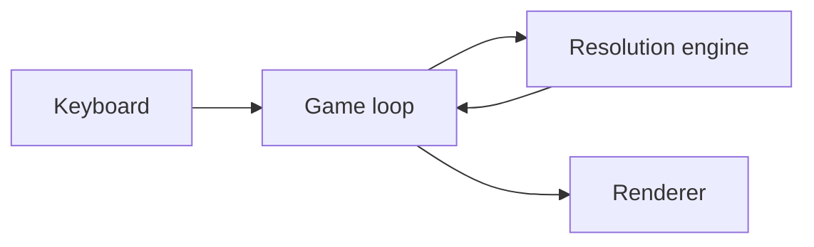

# Tetris Elemental — architecture overview

Entry point for anyone working on Tetris Elemental. The source of truth for
every claim is `Tetris/game/index.html` (classic) and
`Tetris/game-neon/index.html` (neon); for every decision, its node in
`decisions/` — this document only connects them. For the vault itself, see
[[00-START-HERE]]. Verified against the game on 2026-11-11.

## What is Tetris Elemental

A Tetris where every piece is made of one of four elements — fire, water,
earth or air. Classic rules apply (10×20 board, seven tetrominoes, line
clears), plus one governing rule: **opposite elements annihilate on contact**.
Fire cancels water, earth cancels air. Whatever is left falls, which can
trigger further reactions. It is a single-player browser game, a proof of
concept.

## System map

- [[Game loop]] — drops the piece, takes input, spawns the next piece
- [[Resolution engine]] — reactions, gravity, line clears after every lock
- [[Renderer]] — canvas drawing, ghost piece, flash on removal
- [[Neon renderer]] — the same game with glowing neon visuals, shipped as
  `game-neon/index.html`. Rules are identical; only drawing and styling change.

## Vocabulary

| Term | Meaning |
| --- | --- |
| [[Element]] | One of fire, water, earth, air; carried by every cell |
| [[Opposite pair]] | Fire–water and earth–air; touching cells annihilate |
| [[Reaction]] | Removal of all cells touching an opposite |
| [[Column gravity]] | Loose blocks fall after a reaction |
| [[Chain]] | Consecutive removal steps from one lock; multiplies score |
| [[Pure line]] | A full row of a single element; bonus score |
| [[Stable board]] | No opposite contact and no full row at rest |

## The decisions, connected

- **How the board stays consistent:** [[Busy flag over input queue]]
  establishes [[Input lock]], which prevents [[Mid-resolution corruption]] and
  accepts [[Dropped inputs]].
- **How clears behave:** [[Remove every touching cell]] establishes
  [[Stable board]] but enables [[Cascade trivializes difficulty]];
  [[Two gravity models]] keeps overhangs after line clears.
- **How the project is built:** [[Single-file vanilla build]] establishes
  [[No build step]].
- **How the variants coexist:** [[Neon as a separate copy]] establishes
  [[Variants stay in sync]] and enables [[Variant drift]].

## What is designed but not live

- [[Element traits]] — per-element behaviours (faster earth, slower air, water
  that settles). Proposed only; all four elements currently behave the same.
- [[Cascade trivializes difficulty]] — a suspected balance problem, unmeasured.
  Treat as a hypothesis until someone plays enough to confirm.
- [[Variant drift]] — classic and neon could diverge if a rule change is made in
  only one file. Not observed yet.
- Not built and not modelled: touch controls, hold piece, sound, high scores.

## Going deeper

Start at [[MOC Tetris Elemental]]; the two spines are [[MOC Reaction spine]]
and [[MOC Resolution spine]]. When a decision changes, add a new decision note
that `supersedes` the old one rather than rewriting history.
